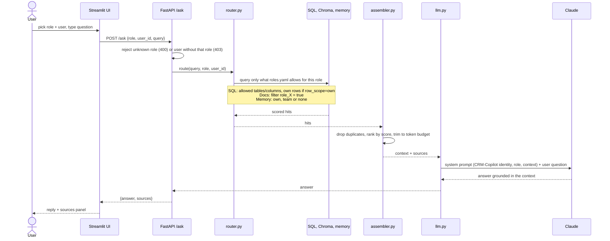

# CRM-Copilot

A role-aware AI assistant for a CRM. Ask a question in plain language and CRM-Copilot answers from your tickets, equipment records, documentation and past notes, **showing each user only what their role permits**, and citing the sources it used.

The demo is a field-service setup (technicians, supervisors, planners). The same code runs any other domain by swapping two config files: see the [Template guide](docs/template-guide.md).

## Features

- **Role-based retrieval.** One file, `roles.yaml`, defines per role which SQL tables and columns, which documents and which memory a user may reach. The restriction is applied when data is fetched, before anything reaches the model.
- **Three sources, one answer.** SQL (structured records), a Chroma vector store (documents) and a memory store (per-user and team notes).
- **Grounded and cited.** The model answers only from the retrieved context, and every response lists its sources.
- **Config-driven.** Roles, tables, paths and the user table live in YAML. No role or table names are hardcoded.

## How a prompt flows



The model never sees data outside the asking user's permissions: filtering happens at the `router` step, before the prompt is built. More detail in [Architecture](docs/architecture.md).

## Quick start

Requires Python 3.10+ and an [Anthropic API key](https://console.anthropic.com/).

```bash
python3 -m venv .venv && source .venv/bin/activate
pip install -r requirements.txt

python scripts/seed_db.py      # create backend/data/demo.db (20 demo rows)
python scripts/ingest.py       # build the vector index (first run downloads a ~80 MB embedding model)

export ANTHROPIC_API_KEY=...
cd backend && uvicorn main:app          # API on http://localhost:8000
# in another terminal, from the repo root:
streamlit run frontend/app.py           # UI on http://localhost:8501
```

Pick a role and user in the sidebar and ask something. Try the same question as different roles to see the boundaries:

| Ask | As | What happens |
|---|---|---|
| "Which router tickets are open?" | Technician (Tom) | Sees only tickets assigned to Tom |
| "Which router tickets are open?" | Supervisor (Sam) | Sees all tickets, including technician notes |
| "What's the status of the X200 router?" | Planner (Priya) | Sees status and equipment, but no ticket notes and no manuals |

### API

```bash
curl -s localhost:8000/ask -H 'content-type: application/json' \
  -d '{"role": "technician", "user_id": 4, "query": "router offline"}'
# {"answer": "...", "sources": ["sql:tickets#1", "doc:manual_x200_reset.txt", ...]}
```

`GET /roles` returns the users for each role. `user_id` must belong to the claimed `role`, otherwise the API returns `403`.

### Tests

```bash
python backend/test_router.py   # permission boundaries and token budget
python backend/test_api.py      # API behaviour, LLM stubbed
python backend/test_llm.py      # prompt wiring; live identity probes run if ANTHROPIC_API_KEY is set
```

The first two need the seeded database and the ingested index.

## Repository layout

```
backend/
  main.py          FastAPI app (POST /ask, GET /roles)
  router.py        role-filtered retrieval from SQL, vector store and memory
  assembler.py     dedupe, rank and trim to a token budget
  llm.py           Claude adapter and CRM-Copilot system prompt
  roles.yaml       permissions per role
  schema.yaml      table, path and user-table names
  data/            demo.db, docs/, memory.json
  vectorstore/     Chroma index (generated, git-ignored)
frontend/app.py    Streamlit UI
scripts/           seed_db.py (demo data), ingest.py (builds the index)
docs/              architecture and template guide
```

## Documentation

- [Architecture](docs/architecture.md): request flow, components and the permission model.
- [Template guide](docs/template-guide.md): adapt CRM-Copilot to a different domain by editing config.

## Limitations

- **No authentication.** `user_id` and `role` are supplied by the caller. The API checks they are consistent, but it does not prove who is calling. Put real auth in front before exposing this beyond a demo.
- **Simple retrieval.** SQL search is keyword matching and token counts are estimated at about four characters per token.
- **Memory is read-only.** `memory.json` is hand-written; conversations are not saved back.
