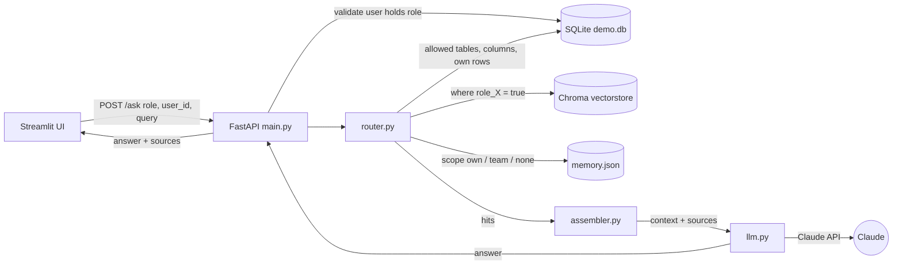

# Architecture

[Back to README](../README.md) · [Template guide](template-guide.md)

CRM-Copilot is a small retrieval-augmented generation (RAG) service. Its defining property is that **permissions are enforced during retrieval**: the model only ever sees data the asking user is allowed to see, so there is nothing for it to leak.

## Request flow



1. The UI sends `{role, user_id, query}` to `POST /ask`.
2. `main.py` rejects unknown roles (400) and a `user_id` that does not hold that role (403).
3. `router.py` queries each source the role may use, applying that role's filters (below).
4. `assembler.py` removes duplicate hits, ranks them by score and keeps as many as fit the token budget.
5. `llm.py` puts the context in the system prompt and asks Claude. The response returns the answer and the list of sources.

## Components

| File | Responsibility |
|---|---|
| `backend/main.py` | HTTP layer, input validation, wiring |
| `backend/router.py` | Retrieval from the three sources, with permission filters |
| `backend/assembler.py` | Dedupe, rank, token budget (default 1500 tokens) |
| `backend/llm.py` | System prompt (CRM-Copilot identity, role, context) and the Claude call |
| `backend/roles.yaml` | Permissions: the single source of truth |
| `backend/schema.yaml` | Names of tables, paths and the user table |
| `scripts/ingest.py` | Chunks documents and writes them to Chroma with visibility metadata |
| `scripts/seed_db.py` | Builds the demo SQLite database |
| `frontend/app.py` | Chat UI: role and user pickers, chat, sources panel |

## Permission model

`roles.yaml` defines each role once:

```yaml
technician:
  sql:
    tickets: [id, assigned_to, status, equipment_id, notes]
    equipment: [id, name, location, last_service]
  row_scope: own        # own | all
  doc_tags: [manual]
  memory: own           # own | team | none
```

Each field is enforced at a different place:

- **SQL tables and columns.** The router builds `SELECT` from the listed columns only. Unlisted columns are never selected, so they cannot be returned or searched. A table not listed is never queried.
- **Row scope.** With `row_scope: own`, tables named in `schema.yaml` under `owner_columns` get `WHERE <owner column> = user_id`.
- **Documents.** `ingest.py` tags each document with its type (the filename prefix, such as `manual_...`) and marks which roles may see it, derived from `doc_tags`. Chroma stores this as one boolean per role (`role_technician: true`). Queries filter on the asking role's flag.
- **Memory.** `own` returns only the user's own notes, `team` returns everyone's, `none` skips memory.

## Data

- **SQLite** holds structured records. The demo has `users`, `tickets` and `equipment`.
- **Chroma** holds document chunks and their embeddings (Chroma's default model, `all-MiniLM-L6-v2`), persisted in `backend/vectorstore/`. Rebuild it with `scripts/ingest.py` whenever documents or `doc_tags` change.
- **`memory.json`** holds short notes per user.

## Ranking and budget

Each source scores hits from 0 to 1: SQL and memory by the fraction of query words matched, documents by `1 / (1 + vector distance)`. The assembler sorts by score, drops duplicates, and skips any hit that would exceed the budget while still trying smaller ones. The token count is an estimate (about four characters per token).

## Security notes

- Filtering happens before the model is called, and the system prompt tells the model to treat context as data, not instructions.
- Table and column names in SQL come from trusted config files, never from request input. Values are bound as parameters.
- There is no authentication. The server verifies that `user_id` holds the claimed `role`, but a caller can still choose any pair. Add real authentication before any non-demo use.
